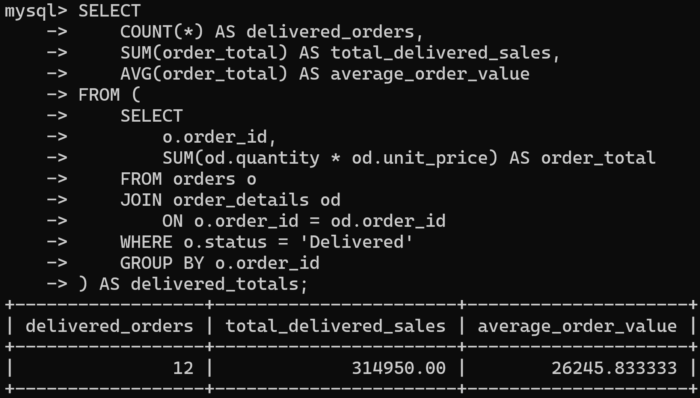
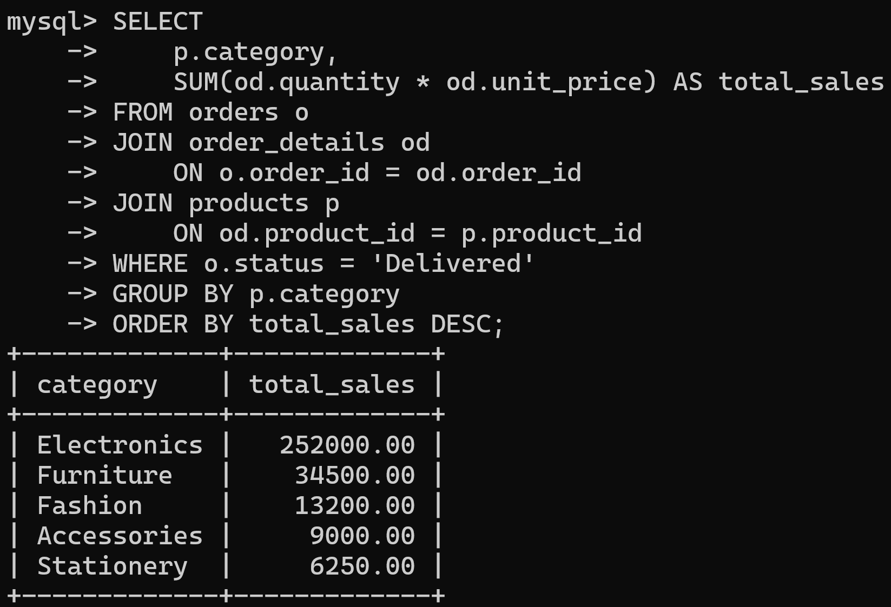
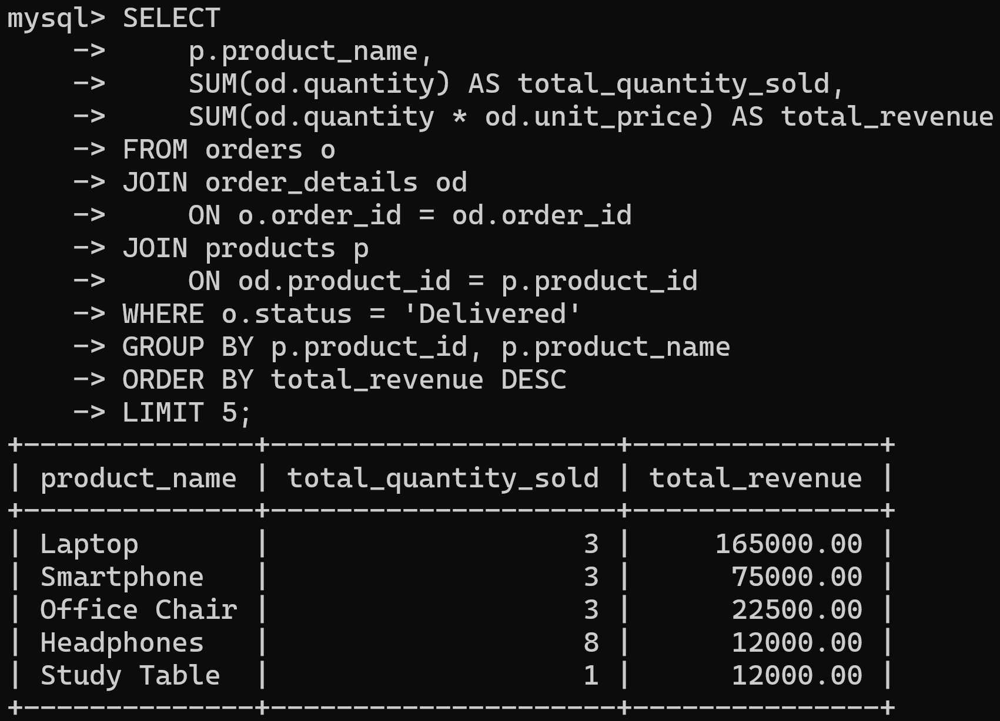
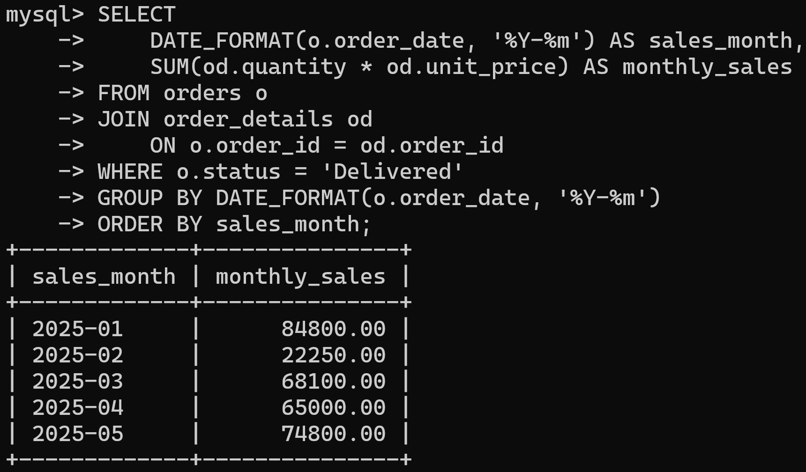
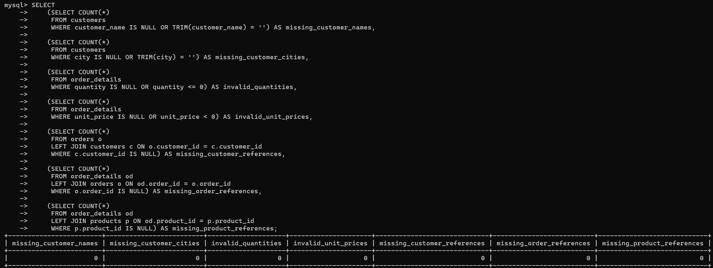
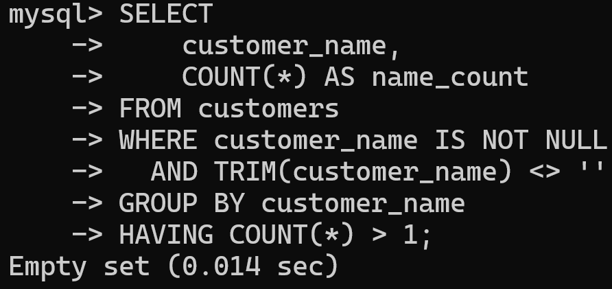

# E-commerce Sales Analysis using MySQL

## Project Overview
This project analyzes fictional e-commerce sales data using MySQL to identify sales trends, top-performing products, customer spending patterns, order statuses, and data quality issues.

## Tools and Technologies
- SQL
- MySQL 9.3.0 Command Line Client

## Database Structure
The database contains four related tables:
- `customers` – Customer details
- `products` – Product names, categories, and prices
- `orders` – Order dates and statuses
- `order_details` – Products, quantities, and unit prices for each order

## Analysis Performed
- Calculated order-wise totals and delivered sales.
- Analyzed monthly and category-wise sales.
- Identified top products by quantity sold and revenue.
- Evaluated customer spending and repeat purchases.
- Calculated average order value.
- Summarized orders by status.
- Checked missing values, duplicate customer names, invalid quantities and prices, and missing order/product references.

## Key Findings
- Total delivered sales were ₹314,950 across 12 delivered orders.
- Electronics was the highest-sales category, contributing ₹252,000 in delivered sales.
- January 2025 had the highest monthly delivered sales at ₹84,800 in this sample dataset.
- Laptop was the top product by revenue, generating ₹165,000.
- Aarav Sharma had the highest delivered-order spending at ₹123,500.
- The dataset contained 12 delivered orders, 2 pending orders, and 1 cancelled order.
- The performed data quality checks did not identify missing customer names or cities, duplicate customer names, invalid quantities or unit prices, or missing order/product references.

## Key Results

| Metric | Result |
|---|---:|
| Total Delivered Sales | ₹314,950 |
| Delivered Orders | 12 |
| Average Order Value (AOV) | ₹26,245.83 |
| Highest-Sales Category | Electronics — ₹252,000 |
| Top Product by Revenue | Laptop — ₹165,000 |
| Highest-Spending Customer | Aarav Sharma — ₹123,500 |
| Most-Sold Product by Quantity | Notebook Pack — 19 units |

### Monthly Delivered Sales

| Month | Sales |
|---|---:|
| January 2025 | ₹84,800 |
| February 2025 | ₹22,250 |
| March 2025 | ₹68,100 |
| April 2025 | ₹65,000 |
| May 2025 | ₹74,800 |

### Data Quality Check Results

The performed checks returned no issues for the following:

- Missing customer names or cities
- Duplicate customer names
- Invalid quantities or unit prices
- Missing customer, order, or product references

## SQL Concepts Used
- SELECT, WHERE, ORDER BY, GROUP BY, HAVING
- Aggregate functions: SUM(), COUNT(), AVG()
- JOIN and LEFT JOIN
- Subqueries
- CASE expressions
- Data quality checks

## Project Files
- `sql/01_database_setup.sql` – Database, table creation, and sample data setup queries
- `sql/02_sales_analysis.sql` – Sales and customer analysis queries
- `sql/03_data_quality_checks.sql` – Data quality validation queries
- `01_Complete_SQL_Queries.sql` – Complete collection of SQL queries

## Screenshots

### 1. Delivered Sales and Average Order Value

### 2. Category-wise Sales

### 3. Top-selling Products

### 4. Monthly Delivered Sales

### 5. Data Quality Checks

### 6. Duplicate Customer Names Check

## Note
This project uses fictional sample data for learning and demonstration. The findings apply only to this dataset and do not represent a real e-commerce business.

## Author
Md Ziyauddin

GitHub: [ziyauddinofficial01-dev](https://github.com/ziyauddinofficial01-dev)
